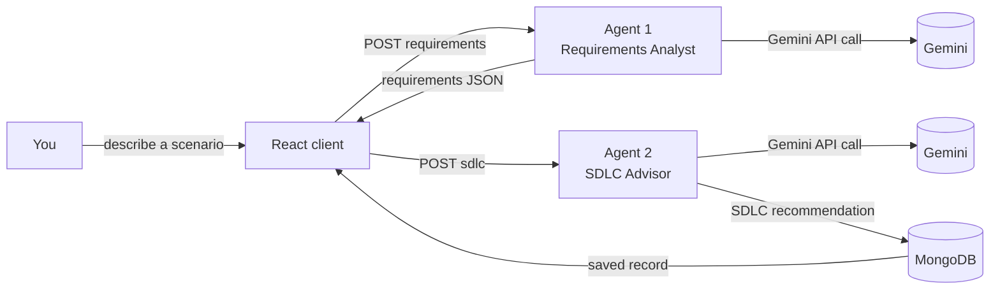

# FirstDraft — a two-agent Requirements & SDLC assistant

FirstDraft is a small MERN application built for a Software Engineering course project. You
describe a software scenario, feature, or module in plain language, and two AI agents work on
it one after another:

1. **Requirements Analyst agent** — reads the scenario and drafts structured functional requirements,
   non-functional requirements and scenario-specific constraints.
2. **SDLC Advisor agent** — receives those requirements and recommends a suitable Software
   Development Life Cycle (SDLC) model, with a justification and ranked alternatives.

Every completed analysis is saved to MongoDB so you can revisit it later from the History tab.

> **Note:** this version of the project uses Google's **Gemini API**, which has a genuinely
> free tier (no credit card needed for a free API key). An earlier version of these docs used
> Anthropic's Claude API instead — if you'd rather use that, swap `server/agents/baseAgent.js`
> back to the Anthropic SDK; the two agents' logic doesn't need to change either way.

> A reference problem statement was provided alongside this brief (see `Problem_Statement.docx`
> if you still have it). That document describes a much larger, finance-sector platform with 13
> collaborating agents, retrieval-augmented generation, compliance mapping, and more. This project
> intentionally implements just the two agents the assignment asks for, in a generic (not
> finance-specific) way. The "Relationship to the full problem statement" section near the bottom
> explains how the pieces map to each other, which may help if you need to justify the scope of
> your prototype.

## How the two agents work



The two agents never talk to each other directly — the Express API orchestrates the hand-off:
Agent 1's JSON output becomes part of Agent 2's prompt. This is what makes it a genuinely
**agentic**, multi-step pipeline rather than one long prompt: each agent has one job, its own
system prompt, and only the context it needs.

Both agents live in `server/agents/` as small classes built on a shared `Agent` base class
(`server/agents/baseAgent.js`) that knows how to call the Gemini API and parse a JSON reply.
Reading those three files is the fastest way to understand the whole system.

## Tech stack

| Layer | Choice |
| --- | --- |
| Database | MongoDB + Mongoose |
| Backend | Node.js + Express 5 |
| Frontend | React 19 + Vite |
| Agents / LLM | Google Gemini API (`@google/genai`) — free tier, no credit card required |

## Project structure

```
firstdraft/
├── server/                    Express API
│   ├── agents/
│   │   ├── baseAgent.js       Shared Agent class (Gemini call + JSON parsing)
│   │   ├── requirementsAgent.js   Agent 1 - Requirements Analyst
│   │   └── sdlcAgent.js           Agent 2 - SDLC Advisor
│   ├── config/db.js           MongoDB connection
│   ├── models/Analysis.js     Mongoose schema for a saved analysis
│   ├── routes/analysis.js     API routes that orchestrate the two agents
│   ├── server.js              App entry point
│   └── .env.example
└── client/                    React app (Vite)
    └── src/
        ├── components/        ScenarioForm, AgentPipeline, RequirementsPanel, SDLCPanel, HistoryView, TopBar
        ├── api.js              Fetch helpers for the backend
        └── App.jsx
```

## Prerequisites

- Node.js 20 LTS or newer (the dependencies use current major versions of Express, Mongoose,
  and Vite — an older Node may not work)
- MongoDB running locally, **or** a free [MongoDB Atlas](https://www.mongodb.com/atlas) cluster
- A free Gemini API key from [Google AI Studio](https://aistudio.google.com/app/apikey)
  (no credit card required)

## Setup

**1. Backend**

```bash
cd server
npm install
cp .env.example .env
# now open .env and paste in your GEMINI_API_KEY (and MONGO_URI if not using local Mongo)
npm run dev
```

The API starts on `http://localhost:5000`. Visit `http://localhost:5000/api/health` — you
should see `{"status":"ok", ...}` and `apiKeyConfigured: true`.

**2. Frontend** (in a second terminal)

```bash
cd client
npm install
cp .env.example .env   # defaults already point at http://localhost:5000/api
npm run dev
```

Open the URL Vite prints (typically `http://localhost:5173`).

That's it — describe a scenario and click **Run the agents**.

## Getting a Gemini API key (free)

1. Go to [Google AI Studio](https://aistudio.google.com/app/apikey) and sign in with a Google
   account.
2. Click **Create API key**. No credit card is required for the free tier.
3. Paste it into `server/.env` as `GEMINI_API_KEY`.

The free tier's exact request limits can change, so check the key/usage page in AI Studio if
you're curious about your current quota — for a project like this (one or two analyses at a
time while you build and demo it), you're very unlikely to come close to the limit.

`server/.env` also has a `GEMINI_MODEL` setting, defaulted to `gemini-flash-latest` — an alias
that always points at Google's current Flash-tier model, so the project doesn't break when
Google retires an older dated model version. You can pin a specific model name here instead if
you ever need reproducible behaviour across a version change.

## API reference

| Method | Route | Body | What it does |
| --- | --- | --- | --- |
| GET | `/api/health` | — | Basic status check |
| POST | `/api/analysis/requirements` | `{ scenario }` | Runs **Agent 1** only; returns `{ requirements }` |
| POST | `/api/analysis/sdlc` | `{ scenario, requirements }` | Runs **Agent 2** using Agent 1's output, saves the full record to MongoDB, returns the saved document |
| GET | `/api/analysis` | — | Returns the 50 most recent saved analyses |
| DELETE | `/api/analysis/:id` | — | Deletes one saved analysis |

Splitting requirements/sdlc into two calls (rather than one "do everything" endpoint) is what
lets the UI show Agent 1's result the moment it's ready, then visibly hand off to Agent 2 —
mirroring the real two-agent pipeline instead of faking it with a client-side delay.

## Example walkthrough

Input scenario:

> An online library system where members can search the catalogue, reserve books, and pay
> overdue fines.

- **Agent 1** might return functional requirements like *"The system shall let a member search
  the catalogue by title, author, or ISBN"* (`FR-1`) and non-functional requirements like
  *"The system shall process a fine payment within 3 seconds"* (`NFR-1`, category
  *Performance*), each tagged High/Medium/Low priority.
- **Agent 2** receives that requirement list and might recommend **Agile (Scrum)** with an 88%
  match score, reasoning that the requirements are moderate in number and likely to evolve as
  the library adds features, with **Iterative** and **Waterfall** listed as lower-scoring
  alternatives.

Because the requirements are genuinely passed from Agent 1 into Agent 2's prompt, the SDLC
justification will reference the actual requirements it saw, not a generic template.

## Relationship to the full problem statement

The provided problem statement describes a much larger system: 13 specialised agents, a
financial-sector knowledge base, retrieval-augmented generation, compliance/regulatory mapping,
human-approval workflows, and enterprise security controls. This project is a deliberately small
slice of that vision — the two agents the assignment explicitly asks for — kept generic so it
works for any scenario, not just financial services. A few ideas were still borrowed from the
larger document because they made the two agents better without adding real complexity:

- The requirement structure (`id`, `statement`, `category`, `priority`) mirrors the "extract and
  structure requirements" fields in the problem statement, simplified to what a two-agent MVP
  needs.
- The SDLC agent's ranked, percentage-scored recommendations mirror the problem statement's
  "ranked recommendations rather than only one label" idea.
- The SDLC agent's decision factors (requirement stability, complexity, risk, need for frequent
  releases, etc.) are a trimmed-down version of the "SDLC decision factors" list in the
  problem statement.

If you want to extend this project toward the fuller vision later, natural next steps — each of
which is a self-contained addition rather than a rewrite — include:

- Splitting the two agents further (e.g. a separate Conflict-Detection or Compliance agent that
  reviews Agent 1's output before Agent 2 runs).
- Adding retrieval-augmented generation so agents cite an actual policy/knowledge base instead of
  relying only on the model's own knowledge.
- Adding authentication and a human-approval step before an analysis is treated as final.
- Domain-specialising the prompts (e.g. financial services) and adding regulation-mapping fields
  to the requirement schema.

## Troubleshooting

- **"MongoDB connection failed"** — make sure `mongod` is running locally, or that `MONGO_URI`
  in `server/.env` points at a reachable database (e.g. a MongoDB Atlas connection string).
- **"GEMINI_API_KEY is not set"** — add your key to `server/.env` and restart `npm run dev`.
- **"Could not reach the API..."** in the browser — make sure the server terminal is still
  running on port 5000, and that `client/.env`'s `VITE_API_BASE_URL` matches it.
- **CORS errors** — the server already enables CORS for all origins via the `cors` package;
  this should only come up if you changed the server port without updating the client's `.env`.
- **"Gemini rejected the API key" / 429 rate limit** — double check the key was copied in full,
  and that you haven't exceeded the free tier's request rate; wait a few seconds and retry.
- **Agents return an error about invalid JSON** — this is rare (the agents ask Gemini for JSON
  output specifically via `responseMimeType: 'application/json'`), but `baseAgent.js`'s
  `parseJSON` still strips markdown fences and extracts the first JSON object as a fallback in
  case a reply ever slips through with extra text. If it still fails, just try again.

## Notes for your write-up / viva

- The two agents satisfy the assignment's requirement of "at least two agents": Agent 1 does
  task (i) (identify and list requirements), Agent 2 does task (ii) (identify a suitable SDLC),
  and Agent 2's input is explicitly Agent 1's output, so the pipeline is a real multi-agent
  hand-off, not two independent calls.
- Keeping each agent to one responsibility (single-responsibility principle, applied to
  prompts) is what makes the system easy to extend — adding a third agent later just means
  inserting another step in `server/routes/analysis.js`.
